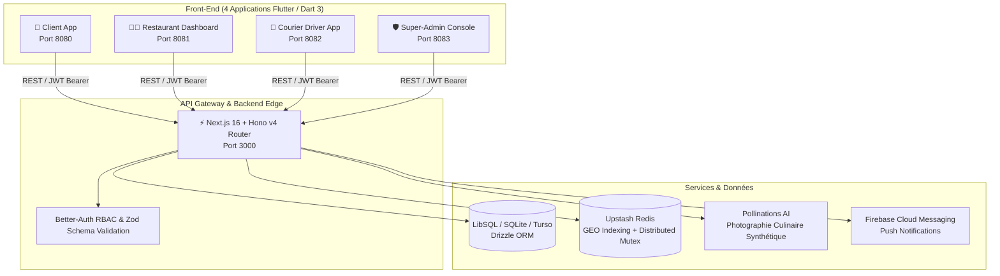

<div align="center">

# 🏝️ Djerba Delivery
### منصة ذكية لإدارة وتتبع التوصيل اللوجستي في جزيرة جربة في الوقت الفعلي
#### Plateforme Intelligente Multi-Acteurs de Livraison Logistique Insulaire en Temps Réel

[](https://nextjs.org/)
[](https://flutter.dev/)
[](https://dart.dev/)
[](https://www.typescriptlang.org/)
[](https://hono.dev/)
[](https://orm.drizzle.team/)
[](https://upstash.com/)
[](https://www.openstreetmap.org/)

<p align="center">
  <b>Stage de Fin d'Année Ingénieur GEC2 (2025–2026)</b><br>
  <b>Auteur :</b> Nour BEN DAOUED &nbsp;|&nbsp; <b>Établissement :</b> ENET'Com Sfax<br>
  <b>Entreprise d'accueil :</b> Loomens (Cyberparc Djerba) &nbsp;|&nbsp; <b>Encadrant :</b> Ayoub Jrab
</p>

[📖 نبذة بالعربية](#-نبذة-عن-المشروع-overview-in-arabic) • [📊 Diaporama](#-documentation--diaporama) • [🏛️ Architecture](#-architecture-système-n-tiers) • [📱 Les 4 Applications](#-les-4-applications-de-lécosystème) • [⚡ Démarrage](#-guide-de-démarrage-rapide)

---

</div>

## 🇹🇳 نبذة عن المشروع (Overview in Arabic)

<div dir="rtl" align="right">

**Djerba Delivery** هي منصة رقمية لوجستية متكاملة ومفتوحة المصدر لإدارة وتتبع عمليات التوصيل في جزيرة جربة في الوقت الفعلي.
تجمع المنصة بين أربعة تطبيقات مترابطة تم تطويرها بتقنية **Flutter 3**، مدعومة بنظام خلفي عالي الأداء يعتمد على **Next.js 16** و **Hono v4** وقواعد بيانات **LibSQL (Turso)** و **Upstash Redis**.

### 🌟 أبرز مميزات المنصة:
- 📱 **تطبيق الحريف (Client App):** تجربة مستخدم سلسة وعصرية، تحديد مباشر ودقيق للموقع عبر الخريطة (OpenStreetMap)، مع دعم خاص للفنادق والمناطق السياحية (اختيار الفندق ورقم الغرفة بكل سهولة).
- 🛵 **تطبيق عامل التوصيل (Driver App):** واجهة مريحة ومصممة للتحكم بيد واحدة أثناء قيادة الدراجة النارية، مزودة برادار مكاني ذكي يحدد الطلبات القريبة في نطاق 5 كم في أقل من 15 مللي ثانية.
- 👨‍🍳 **لوحة تحكم المطاعم (Restaurant Dashboard):** إدارة تفاعلية فورية للطلبات (نظام Kanban)، وإمكانية توليد صور عالية الجودة للأطباق المحلية باستخدام تقنيات الذكاء الاصطناعي التوليدي (Pollinations AI).
- 🛡️ **لوحة التحكم المركزية (Super-Admin):** متابعة شاملة للأسطول وحركة التوصيل عبر الجزيرة مع نموذج عمولة شفاف ومدروس (15%) لدعم أصحاب المشاريع والمطاعم المحلية.

</div>

---

## 📌 Vision & Contexte du Projet

L'île de Djerba (514 km²), joyau culturel et touristique de la Méditerranée, bénéficie d'une vitalité remarquable caractérisée par une alliance harmonieuse entre centres d'activité (Houmt Souk, Midoun), complexes hôteliers et habitations insulaires traditionnelles (Menzels).

**Djerba Delivery** a été conçu pour valoriser cet écosystème en créant une plateforme technologique moderne, fluide et respectueuse des spécificités insulaires :
- **Expérience Touristique & Hôtelière Intuitive :** Un système sur-mesure permettant aux vacanciers de commander avec une sélection directe de l'hôtel et du numéro de chambre, en complément du repérage GPS cartographique OpenStreetMap.
- **Souveraineté & Performance Économique :** Exploitation d'outils cartographiques ouverts (**OpenStreetMap / Leaflet**), garantissant 0 € de surcoût d'API récurrent pour l'écosystème local.
- **Partenariat Équitable avec les Restaurateurs :** Modèle tarifaire juste et transparent (commission de 15% contre 25% à 35% sur les plateformes généralistes).
- **Valorisation Numérique du Patrimoine Culinaire :** Module d'enrichissement par IA pour sublimer les cartes des restaurants djerbiens.

---

## 📚 Documentation & Diaporama

| Ressource | Emplacement / Format | Description |
| :--- | :--- | :--- |
| **📑 Diaporama Officiel** | [`docs/presentation/Soutenance_Djerba_Delivery_2026.pdf`](docs/presentation/Soutenance_Djerba_Delivery_2026.pdf) | Présentation de soutenance (18 diapositives haute fidélité). |
| **📘 Guide Maître Backend** | [`docs/guides/Djerba_Backend_Master_Guide.pdf`](docs/guides/Djerba_Backend_Master_Guide.pdf) | Spécification technique approfondie de l'API Hono/Next.js, schémas Drizzle et flux Redis. |
| **📗 Guide d'Intégration** | [`docs/guides/Djerba_Delivery_Project_Guide.pdf`](docs/guides/Djerba_Delivery_Project_Guide.pdf) | Manuel complet de déploiement et d'architecture des 4 applications Flutter. |

---

## 🏛️ Architecture Système N-Tiers

L'écosystème repose sur un découpage modulaire à haute performance et haute résilience :



---

## 📱 Les 4 Applications de l'Écosystème

### 1. Application Client (Flutter Web & Mobile)
Conçue sur-mesure pour les résidents et les vacanciers avec pointage direct sur carte OpenStreetMap et bascule automatique « Livraison Hôtel » (Sélection de l'hôtel + n° de chambre sans ambiguïté).

<div align="center">
  
  
  
</div>

### 2. Application Livreur / Courier (Flutter Mobile)
Ergonomie pensée pour l'usage à une main au guidon : stepper linéaire à action contextuelle unique, radar spatial de courses disponibles, guidage cartographique et prise d'appel client directe.

<div align="center">
  
  
  
</div>

### 3. Dashboard Restaurateur (Flutter Web & Tablette)
Gestion en direct des commandes par colonnes d'état Kanban réactives (À traiter, En préparation, Prêt coursier), gestionnaire dynamique de menu et générateur visuel de plats par IA.

<div align="center">
  
  
  
</div>

### 4. Console Super-Admin (Flutter Web)
Pilotage global des flux logistiques insulaires, gestion des utilisateurs, validation des coursiers et paramétrage du modèle de commission équitable (15%).

<div align="center">
  
  
</div>

---

## 💡 Innovations Techniques & Algorithmes

### 📡 1. Radar Spatial 5 km (Upstash Redis GEO)
- Les coursiers actifs transmettent leurs coordonnées géographiques toutes les 15 secondes via `GEOADD`.
- Un mécanisme d'éviction automatique avec TTL de 300 s exclut silencieusement tout coursier inactif.
- Dès qu'une commande passe à l'état `ready_for_pickup`, le backend déclenche un `GEOSEARCH` à rayon de 5 km exécuté en mémoire en **moins de 15 millisecondes**, notifiant uniquement les coursiers les plus proches.

### 🔒 2. Mutex Distribué Anti-Collision (`SET NX EX 10`)
Pour prévenir les conflits d'acceptation simultanée lorsque plusieurs coursiers cliquent en même temps sur une nouvelle course :
```typescript
// Acquisition atomique avec TTL de 10 secondes
const acquired = await DispatchService.lockOrder(orderId, driverId);
if (!acquired || currentOrder.driverId) {
  return c.json({ error: "Course déjà assignée à un autre coursier" }, 409); // 409 Conflict
}
// 200 OK -> Attribution unique garantie sans collision
```

### 📈 3. Machine d'État Strictement Monotone
Pour garantir l'intégrité absolue de la chaîne logistique, le statut d'une commande obéit à une fonction de poids strictement croissante :
$$\text{Poids}(\text{nouveau}) \ge \text{Poids}(\text{actuel})$$
```
pending (0) ➔ accepted (1) ➔ preparing (2) ➔ ready_for_pickup (3) ➔ picked_up (4) ➔ arrived_at_place (5) ➔ delivered (6)
```
*Toute tentative de régression (ex: tentative de repasser de `delivered` vers `preparing`) est immédiatement rejetée avec une erreur HTTP 400 Bad Request.*

### 🎨 4. IA Culinaire Générative (Pollinations AI + Cache HTTP)
Permet aux restaurateurs de générer instantanément des visuels de haute qualité de leurs spécialités méditerranéennes avec mise en cache CDN (`max-age=31536000`).

---

## 📂 Structure du Répertoire Monorepo

```plaintext
djerba-delivery-backend/
├── .github/workflows/           # Intégration continue & déploiement automatique Vercel
├── djerba_backend/              # API REST Next.js 16 + Hono v4 (TypeScript, Drizzle, LibSQL)
│   ├── src/
│   │   ├── app/                 # Routes Next.js
│   │   ├── db/                  # Schémas Drizzle ORM (users, orders, restaurants, products)
│   │   └── server/              # Moteur Hono (routes admin, ai, drivers, orders, auth)
│   ├── scripts/                 # Scripts de test & seeding (seed_orders.ts)
│   └── .env.example             # Modèle des variables d'environnement documentées
├── djerba_client_app/           # Application Mobile/Web Client Flutter
├── djerba_driver_app/           # Application Mobile Livreur Scooter Flutter
├── djerba_restaurant_dashboard/ # Dashboard Web Cuisine Restaurateur Flutter
├── djerba_admin_dashboard/      # Console Web Super-Admin Flutter
├── docs/                        # Documentation d'ingénierie & diaporama
│   ├── guides/                  # Guides PDF & HTML détaillés du projet et du backend
│   └── presentation/            # Soutenance officielle ENET'Com 2026 (PDF sans filigrane)
├── report_screenshots/          # Captures d'écran HD des 4 applications et diagrammes
├── quad_view.html               # Vue 4-en-1 synchronisée pour démonstration sur grand écran
├── serve_all.js                 # Serveur HTTP multi-ports orchestrant les 4 apps web + Quad View
└── .gitignore                   # Exclusion stricte des artefacts de build, secrets et logs
```

---

## 🚀 Guide de Démarrage Rapide

### Prérequis
- [Node.js](https://nodejs.org/) v20+
- [Flutter SDK](https://flutter.dev/) v3.22+
- Navigateur Chrome / Edge pour le mode Web multi-applications

### 1. Cloner le Répertoire
```bash
git clone https://github.com/Nour2004-ipeit/djerba-delivery.git
cd djerba-delivery
```

### 2. Démarrer le Backend
```bash
cd djerba_backend
npm install
cp .env.example .env
# Renseignez vos clés dans .env, puis initialisez la base de données :
npm run db:push
npm run dev
# L'API Hono démarre sur http://localhost:3000
```

### 3. Lancer les 4 Applications Front-End Simultanément
Grâce à l'orchestrateur inclus `serve_all.js`, vous pouvez servir l'ensemble des 4 applications Flutter web en une seule commande :
```bash
# À la racine du projet :
node serve_all.js
```

Accédez ensuite à la vue en grille multi-écrans sur :
👉 **[http://localhost:8085](http://localhost:8085)** (*Quad View synchronisée*)

| Application | URL Directe | Port |
| :--- | :--- | :--- |
| **Application Client** | `http://localhost:8080` | 8080 |
| **Cuisine Restaurateur** | `http://localhost:8081` | 8081 |
| **Livreur Coursier** | `http://localhost:8082` | 8082 |
| **Console Super-Admin** | `http://localhost:8083` | 8083 |
| **Vue Grille 4-en-1** | `http://localhost:8085` | 8085 |

---

## 🎓 Remerciements & Affiliation Académique

Ce projet a été conçu et réalisé dans le cadre du **Stage de Perfectionnement Ingénieur (GEC2)** à l'**École Nationale d'Électronique et des Télécommunications de Sfax (ENET'Com)**, en collaboration avec la startup **Loomens** (Cyberparc Djerba).

- **Auteur :** Nour BEN DAOUED
- **Encadrant Industriel :** Ayoub Jrab (Loomens)
- **Année Académique :** 2025–2026 / 2026–2027

---
<div align="center">
  <i>Développé avec fierté pour l'île des rêves, Djerba 🏝️🇹🇳</i>
</div>
