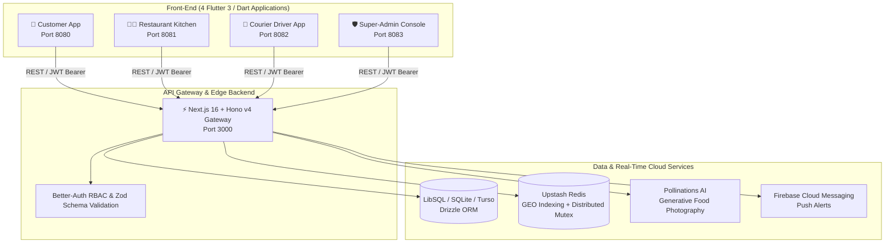

<div align="center">

# 🏝️ Djerba Delivery
### Intelligent Real-Time Multi-Actor Island Logistics Platform

[](https://nextjs.org/)
[](https://flutter.dev/)
[](https://dart.dev/)
[](https://www.typescriptlang.org/)
[](https://hono.dev/)
[](https://orm.drizzle.team/)
[](https://upstash.com/)
[](https://www.openstreetmap.org/)

<p align="center">
  <b>Engineering Degree Advanced Internship (GEC2, 2025–2026)</b><br>
  <b>Author:</b> Nour BEN DAOUED &nbsp;|&nbsp; <b>Institution:</b> ENET'Com Sfax &nbsp;|&nbsp; <b>Host Organization:</b> Loomens (Cyberparc Djerba)
</p>

[📌 Project Vision](#-project-vision--context) • [📑 Slides & Docs](#-documentation--presentation-slides) • [🏛️ System Architecture](#-n-tier-system-architecture) • [📱 The 4 Ecosystem Apps](#-the-4-ecosystem-applications) • [🚀 Quick Start](#-quick-start-guide)

---

</div>

## 📌 Project Vision & Context

Renowned as the Mediterranean's "Island of Dreams", Djerba (514 km²) blends rich traditional architecture (historic Menzels), vibrant bustling town centers (Houmt Souk, Midoun), and a world-class coastal resort sector.

**Djerba Delivery** was engineered from the ground up to empower this dynamic island ecosystem with a state-of-the-art, open, and equitable real-time delivery platform:

- **Seamless Tourist & Hotel Delivery:** Tailored hotel integration allowing travelers to effortlessly place orders with instant resort and room number selection, alongside precise OpenStreetMap geolocation.
- **Sovereign & Cost-Free Mapping Infrastructure:** Powered exclusively by open-source GIS technology (**OpenStreetMap & Leaflet**), eliminating expensive recurring proprietary map API bills for local merchants.
- **Fair Economic Partnership:** An accessible, transparent 15% flat commission structure designed to support island restaurateurs and couriers rather than high 25%–35% platform fees.
- **Culinary AI Visual Showcase:** Integrated generative AI to dynamically create studio-grade photography of traditional Mediterranean dishes, empowering local restaurants with zero onboarding friction.

---

## 📚 Documentation & Presentation Slides

| Resource | Location / Format | Details |
| :--- | :--- | :--- |
| **📑 Official Defense Slides** | [`docs/presentation/Soutenance_Djerba_Delivery_2026.pdf`](docs/presentation/Soutenance_Djerba_Delivery_2026.pdf) | Complete 18-slide engineering defense presentation. |
| **📘 Backend Master Guide** | [`docs/guides/Djerba_Backend_Master_Guide.pdf`](docs/guides/Djerba_Backend_Master_Guide.pdf) | In-depth technical specification of Hono/Next.js endpoints, Drizzle schemas, and Redis streams. |
| **📗 Project Integration Guide** | [`docs/guides/Djerba_Delivery_Project_Guide.pdf`](docs/guides/Djerba_Delivery_Project_Guide.pdf) | Comprehensive architectural manual covering all 4 Flutter client applications. |

---

## 🏛️ N-Tier System Architecture

The monorepo operates on a clean, scalable distributed architecture designed for low latency and high concurrency:



---

## 📱 The 4 Ecosystem Applications

### 1. Customer App (Flutter Mobile & Web)
Tailored for island residents and visitors with OpenStreetMap interactive pin placement, specialized hotel delivery mode, dish customization, dynamic cart management, and live courier tracking.

<div align="center">
  
  
  
</div>

### 2. Courier Driver App (Flutter Mobile)
Ergonomically designed for one-handed operation while riding: single-action linear stepper buttons (*On the Way*, *Arrived*, *Picked Up*, *Delivered*), spatial radar dispatching, and direct customer calling.

<div align="center">
  
  
  
</div>

### 3. Restaurant Kitchen Dashboard (Flutter Web & Tablet)
Real-time Kanban order management (*New Requests*, *Preparing*, *Ready for Driver*), dynamic stock and menu availability toggles, and generative AI dish photography.

<div align="center">
  
  
  
</div>

### 4. Super-Admin Console (Flutter Web)
Centralized supervisory dashboard providing whole-island real-time operational visibility, driver onboarding approval, merchant management, and analytics reporting.

<div align="center">
  
  
</div>

---

## 💡 Core Technical Innovations

### 📡 1. Upstash Redis 5 km Spatial Radar
- Active couriers stream their GPS coordinates every 15 seconds via `GEOADD`.
- An automatic TTL eviction policy (300 s) safely purges inactive couriers to avoid false alerts.
- Once a meal is marked `ready_for_pickup`, the server executes a circular `GEOSEARCH` query in memory in **under 15 milliseconds**, notifying only couriers within a 5 km radius ordered by distance.

### 🔒 2. Distributed Atomic Anti-Collision Mutex (`SET NX EX 10`)
Prevents race conditions when multiple couriers simultaneously attempt to accept the same high-demand order:
```typescript
// Atomic mutex acquisition with a 10-second TTL
const acquired = await DispatchService.lockOrder(orderId, driverId);
if (!acquired || currentOrder.driverId) {
  return c.json({ error: "Delivery task already claimed by another courier" }, 409); // 409 Conflict
}
// 200 OK -> Guaranteed unique assignment without duplication
```

### 📈 3. Strictly Monotonic Order State Machine
To guarantee bulletproof transaction integrity across 4 distributed actors, order statuses follow a strictly increasing weight function:
$$\text{Weight}(\text{new}) \ge \text{Weight}(\text{current})$$
```
pending (0) ➔ accepted (1) ➔ preparing (2) ➔ ready_for_pickup (3) ➔ picked_up (4) ➔ arrived_at_place (5) ➔ delivered (6)
```
*Any attempt to reverse the state (e.g., reverting from `delivered` to `preparing`) is automatically rejected with an HTTP 400 Bad Request.*

### 🎨 4. Generative Culinary AI (Pollinations AI + HTTP Caching)
Allows small traditional food spots and restaurants to instantly generate appetizing, studio-grade visual assets for their specialties with permanent edge HTTP caching (`max-age=31536000`).

---

## 📂 Monorepo Directory Structure

```plaintext
djerba-delivery-backend/
├── .github/workflows/           # Automated CI/CD pipeline (Vercel deployment)
├── djerba_backend/              # High-performance Next.js 16 + Hono v4 REST API
│   ├── src/
│   │   ├── app/                 # Next.js app entrypoints
│   │   ├── db/                  # Drizzle ORM schemas (users, orders, restaurants, products)
│   │   └── server/              # Hono core router (admin, ai, drivers, orders, auth)
│   ├── scripts/                 # Utility & database seeding scripts (seed_orders.ts)
│   └── .env.example             # Clean environment configuration template
├── djerba_client_app/           # Customer mobile & web Flutter app
├── djerba_driver_app/           # Courier driver mobile Flutter app
├── djerba_restaurant_dashboard/ # Restaurant kitchen management web Flutter app
├── djerba_admin_dashboard/      # Super-Admin oversight web Flutter app
├── docs/                        # Engineering guides and presentation slides
│   ├── guides/                  # Master guides & HTML technical specifications
│   └── presentation/            # Official 2026 defense slides (clean PDF)
├── report_screenshots/          # High-resolution application screenshots
├── quad_view.html               # 4-in-1 synchronized testing screen
├── serve_all.js                 # Multi-port server running all 4 web frontends + Quad View
└── .gitignore                   # Comprehensive ignore rules for build artifacts and secrets
```

---

## 🚀 Quick Start Guide

### Prerequisites
- [Node.js](https://nodejs.org/) v20+
- [Flutter SDK](https://flutter.dev/) v3.22+
- Google Chrome or Edge for multi-application web testing

### 1. Clone the Repository
```bash
git clone https://github.com/Nour2004-ipeit/djerba-delivery.git
cd djerba-delivery
```

### 2. Start the Backend API
```bash
cd djerba_backend
npm install
cp .env.example .env
# Populate your environment secrets in .env, then push database schema:
npm run db:push
npm run dev
# Hono API is live at http://localhost:3000
```

### 3. Launch All 4 Frontends Simultaneously
Using the built-in orchestrator script, you can serve all 4 Flutter web applications in a single command:
```bash
# From the project root:
node serve_all.js
```

Then open the synchronized multi-window interface:
👉 **[http://localhost:8085](http://localhost:8085)** (*Synchronized Quad View*)

| Application | Direct URL | Port |
| :--- | :--- | :--- |
| **Customer App** | `http://localhost:8080` | 8080 |
| **Restaurant Kitchen** | `http://localhost:8081` | 8081 |
| **Courier Driver** | `http://localhost:8082` | 8082 |
| **Super-Admin Console** | `http://localhost:8083` | 8083 |
| **Synchronized Quad View** | `http://localhost:8085` | 8085 |

---

## 🎓 Academic Affiliation & Acknowledgments

This engineering project was conceptualized and developed as part of the **Advanced Engineering Practical Internship (GEC2)** at the **National School of Electronics and Telecommunications of Sfax (ENET'Com)**, in collaboration with **Loomens** (Cyberparc Djerba).

- **Author:** Nour BEN DAOUED
- **Host Organization:** Loomens (Cyberparc Djerba)
- **Academic Year:** 2025–2026 / 2026–2027

---
<div align="center">
  <i>Engineered with pride for the Island of Dreams, Djerba 🏝️</i>
</div>
